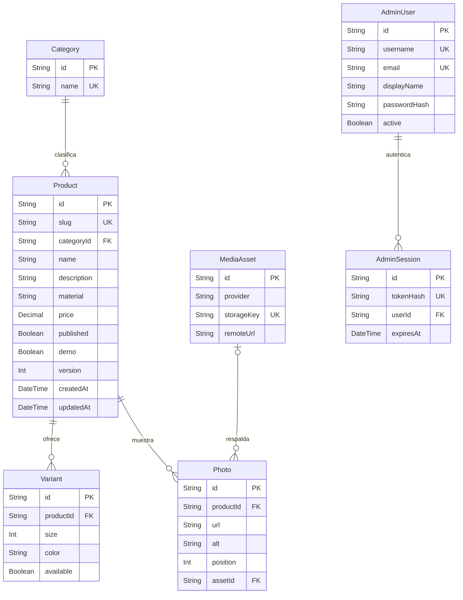

# Modelo de datos de Top Walker

Estado: reglas confirmadas por el usuario el 18 de noviembre de 2026, ampliadas con administración el 19 de noviembre. Fuente funcional: `Top_Walker.docx`, RF/HU-01, 02, 04 y 06–10. Implementación: `backend/prisma/schema.prisma` y migraciones `202611180001_initial_catalog` y `202611190001_administration`.

## Relaciones



El backend administrativo valida los campos obligatorios de RF-07, al menos una variante y una galería con imagen principal tanto al registrar como al editar. Puede guardarse completo pero retirado, sin hacerlo visible. La migración administrativa es aditiva: mantiene productos, variantes, fotos e IDs anteriores.

## Reglas confirmadas y representación

| Regla | Representación y restricciones |
| --- | --- |
| Disponibilidad por talla y color | `Variant` pertenece a un `Product`. La clave única `(productId, size, color)` impide repetir una combinación. |
| Disponible o agotado, sin cantidades | `Variant.available`: `true` = disponible, `false` = agotado. Valor inicial `false`. No hay columnas de cantidad, movimientos ni reservas. |
| Precio único por modelo | `Product.price`, decimal exacto de 10 dígitos y 2 decimales, en Bs. SQL exige precio mayor que cero. Las variantes no tienen precio. |
| Publicación manual | `Product.published` comienza en `false`. Solo una operación administrativa autorizada podrá cambiarlo. El catálogo consulta exclusivamente `true`. |
| Varias fotografías ordenadas y una principal | `Photo` pertenece al modelo, tiene URL, texto alternativo y posición entera no negativa. `(productId, position)` es único. La posición 0 identifica la principal. |
| Retirada reversible | Retirar actualiza `published=false`; republicar lo cambia a `true`. Conserva producto, ID, slug, variantes, fotos y precio. No elimina registros. |

Se conservan booleanos porque cada estado tiene exactamente dos posibilidades. No se duplican como enumeraciones ni campos adicionales que puedan contradecirse. Un producto no publicado puede estar aún en preparación o haber sido retirado: ambos tienen el mismo comportamiento público definido en RF-09; no se necesita un historial de estados para el alcance actual.

La disponibilidad y la publicación son independientes: agotar todas las combinaciones **no retira automáticamente** el modelo. Un modelo publicado puede mostrar sus combinaciones agotadas. El filtro por talla solo devuelve modelos publicados con alguna combinación disponible en esa talla.

## Ejemplo de variantes

Un modelo con precio **Bs 469,00** puede contener:

| Talla | Color | Estado |
| --- | --- | --- |
| 38 | Marrón | Agotado |
| 38 | Negro | Disponible |
| 39 | Marrón | Disponible |

La talla 38 coincide con el filtro público por su combinación negra. Seleccionar marrón no puede mostrar esa talla como disponible. Cambiar el precio del modelo afecta a las tres combinaciones.

## Galería e integridad

- Ordenar siempre por `position ASC`; el catálogo utiliza la primera fotografía. La convención del escritor es una secuencia `0, 1, 2, ...`.
- No se añade `isPrimary`: dos fuentes de verdad permitirían que la posición y la marca principal se contradijeran.
- La base de datos garantiza posiciones no negativas y no repetidas. **No garantiza por sí sola que exista la posición 0 ni que no haya huecos**. `AdminService` normaliza la secuencia transaccionalmente y exige principal al publicar.
- Reordenar debe realizarse en una transacción: mover primero las posiciones a un rango temporal libre y después asignar la secuencia definitiva. Así no se viola la unicidad durante un intercambio. Al eliminar una foto, renumerar las restantes en esa misma transacción.
- Las fotografías pertenecen al modelo, no a cada combinación. No se presupone que cambiar el color cambie la foto.
- `url` almacena una referencia, no el archivo binario. Las cargas administrativas enlazan con `MediaAsset` y `/api/media/:id`; el proveedor conserva archivo local o referencia de Cloudinary. `assetId` es opcional para conservar las fotografías demostrativas anteriores sin migrarlas ni sustituirlas.

## Restricciones y responsabilidades

La migración existente ya aplica claves foráneas, unicidad de slug y categoría, unicidad de combinaciones y posiciones, `price > 0`, `size > 0` y `position >= 0`. Prisma no expresa estos `CHECK` en el esquema: se conservan en el SQL versionado.

Las tallas enteras y los nombres de color se mantienen como en el catálogo actual. El backend de escritura normaliza espacios y mayúsculas para no registrar, por ejemplo, `Negro` y ` negro ` como opciones distintas. La unicidad actual de PostgreSQL compara el texto almacenado; se complementa con esa normalización. Las variantes retenidas conservan sus IDs incluso cuando se intercambian talla/color; solo se eliminan combinaciones que el administrador quitó expresamente del formulario.

No se crean tablas maestras de tallas/colores: el alcance no requiere gestionarlas de forma independiente y las combinaciones ya expresan la oferta de cada producto. La categoría sí tiene entidad propia para compartir su clasificación y filtrar modelos.

`Category → Product` restringe el borrado de categorías utilizadas. Las relaciones desde producto a variantes/fotos conservan `onDelete: Cascade` para integridad referencial si se ejecutara un borrado físico; **esto no autoriza ni implementa borrar productos**. La retirada funcional siempre es un `UPDATE` y no activa cascadas. No existe endpoint público de borrado.

Los UUID de productos, variantes y fotos se generan mediante Prisma. Los IDs existentes permanecen sin cambios. El precio se entrega como decimal serializado; no se calcula con coma flotante en la base de datos.

## Compatibilidad y límites

La estructura es compatible con las seis confirmaciones. La ampliación administrativa agrega tablas y columnas mediante migración SQL versionada; no cambia la migración inicial aplicada. No se ejecutan `db push`, reseteos, borrados de productos o eliminación de volúmenes.

`AdminUser` almacena las cuentas independientes de propietario y ayudante, con los mismos permisos. `AdminSession` conserva únicamente el hash del token y su vencimiento; cerrar sesión revoca el registro. `LoginAttempt` conserva claves hash, contador y vencimiento para limitar intentos. No existe registro público de cuentas. `Product.version` permite detectar ediciones concurrentes y rechazar escrituras desactualizadas con HTTP 409.

El nombre normalizado del producto se comprueba dentro de una transacción con bloqueo de PostgreSQL para evitar altas simultáneas duplicadas, sin imponer una restricción nueva sobre posibles datos históricos. Las categorías usan el mismo criterio de normalización. Precio, relaciones, variantes, estado y orden de fotografías se guardan de forma atómica.

Este diseño no añade clientes registrados, pedidos, pagos, carrito, fabricación ni inventario cuantitativo. NestJS autoriza todas las operaciones administrativas; el esquema por sí solo no proporciona autenticación.

## Verificación reproducible

```sh
docker compose exec backend npx prisma validate
docker compose exec backend npx prisma migrate status
docker compose exec backend node --test test/model.test.mjs
docker compose exec backend npm run test:integration
```

Las pruebas de modelo crean fixtures dentro de transacciones que se revierten siempre. Comprueban disponibilidad independiente, precio compartido, publicación/republicación, galería ordenada y rechazo de combinaciones, posiciones y valores inválidos; no alteran productos existentes ni requieren una semilla.
