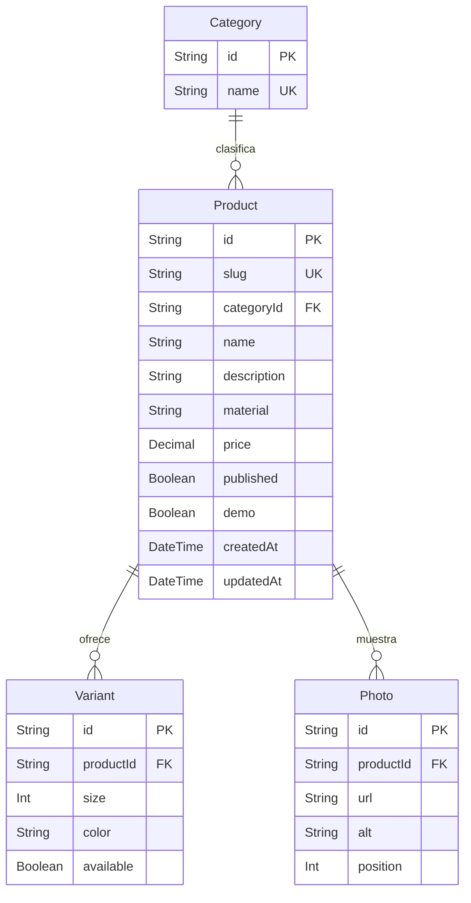

# Modelo de datos de Top Walker

Estado: reglas confirmadas por el usuario el 18 de noviembre de 2026. Fuente funcional: `Top_Walker.docx`, RF/HU-01, 02, 04 y 07–10. Implementación: `backend/prisma/schema.prisma` y migración `202611180001_initial_catalog`.

## Relaciones



Las relaciones permiten guardar un modelo todavía incompleto y no publicado. Para publicarlo, el backend administrativo deberá validar los datos obligatorios de RF-07, sus variantes y una galería con imagen principal. Esa operación administrativa sigue pendiente de implementación.

## Reglas confirmadas y representación

| Regla | Representación y restricciones |
| --- | --- |
| Disponibilidad por talla y color | `Variant` pertenece a un `Product`. La clave única `(productId, size, color)` impide repetir una combinación. |
| Disponible o agotado, sin cantidades | `Variant.available`: `true` = disponible, `false` = agotado. Valor inicial `false`. No hay columnas de cantidad, movimientos ni reservas. |
| Precio único por modelo | `Product.price`, decimal exacto de 10 dígitos y 2 decimales, en Bs. SQL exige precio mayor que cero. Las variantes no tienen precio. |
| Publicación manual | `Product.published` comienza en `false`. Solo una operación administrativa autorizada podrá cambiarlo. El catálogo consulta exclusivamente `true`. |
| Varias fotografías ordenadas y una principal | `Photo` pertenece al modelo, tiene URL, texto alternativo y posición entera no negativa. `(productId, position)` es único. La posición 0 identifica la principal. |
| Retirada reversible | Retirar actualiza `published=false`; republicar lo cambia a `true`. Conserva producto, ID, slug, variantes, fotos y precio. No elimina registros. |

Se conservan booleanos porque cada estado tiene exactamente dos posibilidades. No se duplican como enumeraciones ni campos adicionales que puedan contradecirse. Un producto no publicado puede estar aún en preparación o haber sido retirado: ambos tienen el mismo comportamiento público definido en RF-09; no se necesita un historial de estados para el alcance actual.

La disponibilidad y la publicación son independientes: agotar todas las combinaciones **no retira automáticamente** el modelo. Un modelo publicado puede mostrar sus combinaciones agotadas. El filtro por talla solo devuelve modelos publicados con alguna combinación disponible en esa talla.

## Ejemplo de variantes

Un modelo con precio **Bs 469,00** puede contener:

| Talla | Color | Estado |
| --- | --- | --- |
| 38 | Marrón | Agotado |
| 38 | Negro | Disponible |
| 39 | Marrón | Disponible |

La talla 38 coincide con el filtro público por su combinación negra. Seleccionar marrón no puede mostrar esa talla como disponible. Cambiar el precio del modelo afecta a las tres combinaciones.

## Galería e integridad

- Ordenar siempre por `position ASC`; el catálogo utiliza la primera fotografía. La convención del escritor es una secuencia `0, 1, 2, ...`.
- No se añade `isPrimary`: dos fuentes de verdad permitirían que la posición y la marca principal se contradijeran.
- La base de datos garantiza posiciones no negativas y no repetidas. **No garantiza por sí sola que exista la posición 0 ni que no haya huecos**. La futura escritura administrativa deberá normalizar la secuencia y exigir principal al publicar.
- Reordenar debe realizarse en una transacción: mover primero las posiciones a un rango temporal libre y después asignar la secuencia definitiva. Así no se viola la unicidad durante un intercambio. Al eliminar una foto, renumerar las restantes en esa misma transacción.
- Las fotografías pertenecen al modelo, no a cada combinación. No se presupone que cambiar el color cambie la foto.
- `url` almacena una referencia, no el archivo binario. Podrá apuntar a Cloudinary cuando se configure; las fotos actuales son demostrativas.

## Restricciones y responsabilidades

La migración existente ya aplica claves foráneas, unicidad de slug y categoría, unicidad de combinaciones y posiciones, `price > 0`, `size > 0` y `position >= 0`. Prisma no expresa estos `CHECK` en el esquema: se conservan en el SQL versionado.

Las tallas enteras y los nombres de color se mantienen como en el catálogo actual. El backend de escritura deberá normalizar espacios y la representación de los nombres de color para no registrar, por ejemplo, `Negro` y ` negro ` como opciones distintas. La unicidad actual de PostgreSQL compara el texto almacenado; no sustituye esa normalización.

No se crean tablas maestras de tallas/colores: el alcance no requiere gestionarlas de forma independiente y las combinaciones ya expresan la oferta de cada producto. La categoría sí tiene entidad propia para compartir su clasificación y filtrar modelos.

`Category → Product` restringe el borrado de categorías utilizadas. Las relaciones desde producto a variantes/fotos conservan `onDelete: Cascade` para integridad referencial si se ejecutara un borrado físico; **esto no autoriza ni implementa borrar productos**. La retirada funcional siempre es un `UPDATE` y no activa cascadas. No existe endpoint público de borrado.

Los UUID de productos, variantes y fotos se generan mediante Prisma. Los IDs existentes permanecen sin cambios. El precio se entrega como decimal serializado; no se calcula con coma flotante en la base de datos.

## Compatibilidad y límites

La estructura ya implementada es compatible con las seis confirmaciones. Esta tarea documenta el esquema y añade pruebas de sus invariantes; no necesita una nueva migración ni cambia la migración aplicada. No se ejecutan `db push`, reseteos, borrados de registros o eliminación de volúmenes.

La autenticación, cuentas independientes del propietario y ayudante, sesiones y panel siguen en la etapa administrativa (RF-06 a RF-10). Este diseño de catálogo no añade clientes registrados, pedidos, pagos, carrito, fabricación ni inventario cuantitativo. El usuario administrador que publique un modelo deberá ser autorizado por NestJS; el esquema por sí solo no proporciona autenticación.

## Verificación reproducible

```sh
docker compose exec backend npx prisma validate
docker compose exec backend npx prisma migrate status
docker compose exec backend node --test test/model.test.mjs
docker compose exec backend npm run test:integration
```

Las pruebas de modelo crean fixtures dentro de transacciones que se revierten siempre. Comprueban disponibilidad independiente, precio compartido, publicación/republicación, galería ordenada y rechazo de combinaciones, posiciones y valores inválidos; no alteran productos existentes ni requieren una semilla.
